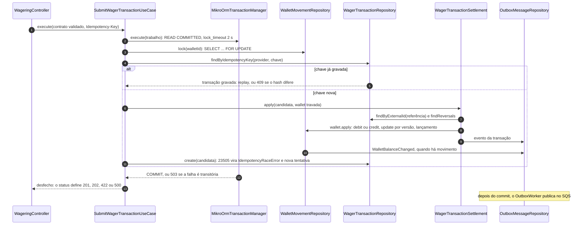

# Decisões de arquitetura

Registro das escolhas, do porquê e do que foi descartado. Cada seção nasce no
incremento que tomou a decisão.

1. [Camadas por módulo](#1-camadas-por-módulo) e a
   [rota de leitura do submit](#rota-de-leitura-o-submit-de-ponta-a-ponta)
2. [Money](#2-money)
3. [Taxonomia de falha e status HTTP](#3-taxonomia-de-falha-e-status-http)
4. [Infraestrutura local](#4-infraestrutura-local): LocalStack, PostgreSQL,
   imagem, por que MikroORM, Bun, servidor HTTP e readiness
5. [Wallet, ledger e invariantes no schema](#5-wallet-ledger-e-invariantes-no-schema)
6. [Transações e erros de banco](#6-transações-e-erros-de-banco): estratégia de
   concorrência, pool e queda de conexão
7. [Extrato e reconciliação](#7-extrato-e-reconciliação)
8. [Submissão de transações de aposta](#8-submissão-de-transações-de-aposta)
9. [Outbox](#9-outbox)
10. [Reversões e referências pendentes](#10-reversões-e-referências-pendentes)
11. [Consumo SQS, inbox e FAILED](#11-consumo-sqs-inbox-e-failed)
12. [Observabilidade](#12-observabilidade)
13. [Autenticação](#13-autenticação)
14. [Trade-offs e limitações](#14-trade-offs-e-limitações)

O teste de carga está em [`docs/load-test.md`](docs/load-test.md).

## 1. Camadas por módulo

Cada contexto de negócio fica em `src/modules/<contexto>/`:

| Pasta | Papel |
|---|---|
| `domain/` | entidades e objetos de valor. TypeScript puro |
| `usecase/` | um caso de uso por operação, em `usecase/<ação>/<ação>.usecase.ts` com o DTO ao lado |
| `gateway/` | as portas: interfaces de repositório e de serviço externo |
| `repository/` | o adaptador que implementa a porta contra o banco, com o model e o mapper |
| `factory/` | monta os casos de uso com as dependências concretas |
| `event/` | os eventos de integração que o contexto publica |

O que é compartilhado entre contextos fica em `src/modules/@shared/`. A borda
(HTTP, fila, workers, banco) fica em `src/infra/`. A pasta só é criada quando
houver arquivo para ela.

**As fronteiras são impostas pelo lint, não por convenção.** O `.oxlintrc.json`
faz `bun run lint` falhar se:

- `domain/` importar NestJS, MikroORM, AWS SDK, class-validator, `infra/`,
  `gateway/`, `repository/`, `usecase/` ou `factory/`;
- `usecase/` importar framework, ORM, `infra/`, `repository/` ou `factory/`;
- `domain/`, `usecase/` ou `gateway/` de um contexto importar outro contexto.

**Contextos conversam por portas de quem consome.** A abertura de wallet precisa
registrar a transação interna `OPENING`, que pertence ao contexto de apostas. Em
vez de o caso de uso da wallet conhecer o domínio de apostas, a wallet declara
`OpeningTransactionGateway` com o que precisa, o contexto de apostas fornece o
adaptador (`OpeningTransactionRepository`) e a `WalletFactory` liga os dois.

**Por que existe `factory/`.** O caso de uso não pode importar NestJS, então não
tem `@Injectable()`, e o container do Nest não consegue construí-lo sozinho. A
factory faz essa montagem em TypeScript puro, e o módulo Nest a chama com
`useFactory`. Ela não duplica o DI: é o que permite o caso de uso ficar livre de
framework. Os testes de integração montam o caso de uso do mesmo jeito, sem
subir o Nest, e trocam um gateway por um que falha para provar atomicidade.

**Nomes.** Arquivos, casos de uso e gateways seguem o padrão `create`/`findById`
dos projetos anteriores. Dentro do agregado ficam os verbos do domínio pedidos
no enunciado: `Wallet.open`, `WalletLedgerEntry.create` e `rehydrate`. O
`LedgerGateway` permite criar e consultar lançamentos; a ausência de `update`
e `delete` expressa no contrato que o ledger não muda.

### Rota de leitura: o submit de ponta a ponta

`POST /wagering/transactions` atravessa todas as camadas e é o melhor ponto de
partida para ler o código. As regras de cada passo estão nas seções 8 a 10.

| Ordem | Arquivo | O que olhar |
|---|---|---|
| 1 | `src/infra/http/wagering/wagering.controller.ts` | header obrigatório, `parseRequest` e o status pelo desfecho |
| 2 | `src/infra/contract/wager-transaction.contract.ts` | o contrato Zod compartilhado entre HTTP e fila |
| 3 | `src/modules/wagering/factory/wagering.factory.ts` | como o caso de uso recebe as dependências concretas |
| 4 | `src/modules/wagering/usecase/submit/submit.usecase.ts` | lock, idempotência e a nova tentativa |
| 5 | `src/infra/database/mikro-orm-transaction-manager.ts` | isolamento, `lock_timeout` e a tradução para 503 |
| 6 | `src/modules/wagering/usecase/wager-transaction-settlement.ts` | rejeitar, aguardar referência ou processar |
| 7 | `src/modules/wagering/domain/wager-transaction.entity.ts` | `rejectionFor`, `awaitsReference` e `ledgerDirectionFor` |
| 8 | `src/modules/wallet/repository/wallet-movement.repository.ts` | a porta que o contexto de apostas usa para mover a wallet |
| 9 | `src/modules/wallet/domain/wallet.entity.ts` | `debit` e `credit` com as invariantes de saldo |
| 10 | `src/modules/wagering/repository/wager-transaction.repository.ts` | o `23505` do índice único virando `IdempotencyRaceError` |
| 11 | `src/infra/http/shared/errors/http-error.filter.ts` | o mapa de falha para status e o `Retry-After` |
| 12 | `src/infra/worker/outbox-worker.ts` | a publicação do que ficou na outbox |

O consumo da fila entra no mesmo caso de uso pelo
`src/infra/worker/wager-message-worker.ts`, com a inbox na mesma transação
(seção 11).

## 2. Money

- **`decimal.js` com construtor clonado e precisão 40.** A precisão padrão (20
  dígitos significativos) vale também para `plus`:
  `999999999999999999.99 + 999999999999999999.99` devolvia
  `2000000000000000000.00`, uma perda silenciosa de 1,98.
- **Validação por regex de formato, nunca `Number()`.** `Number("1e5")`
  devolveria 100000 em silêncio.
- **Contrato de entrada estrito:** não negativo, exatamente 2 casas, sem zero à
  esquerda (`^(0|[1-9]\d{0,17})\.\d{2}$`). O enunciado pede escala fixa de 2.
  Aceitar `"25"` ou `"25.5"` daria duas grafias para a mesma quantia e, com isso,
  dois `payloadHash` para o mesmo pedido. Valores do banco (`NUMERIC(20,2)`) já
  chegam nesse formato.
- **Negativo só nasce dentro do domínio**, por `negate()` ou `subtract()`.
  Aceitá-lo em `from` deixaria a regra "sem negativo em contrato de entrada"
  dependendo de cada DTO lembrar dela. O ledger usa direção + valor positivo, e
  o saldo é não negativo por CHECK, então nenhum caminho de persistência precisa
  reidratar negativo.
- **Faixa de 18 dígitos inteiros**, a mesma de `NUMERIC(20,2)`. Toda operação
  aritmética valida o resultado: um valor que o domínio aceita é um valor que o
  banco grava.
- **Mensagem de erro sem o valor recebido.** Ele fica numa propriedade separada,
  porque mensagem de exceção vai para log e a seção 12 proíbe payload
  financeiro em log.
- **No banco, `NUMERIC(20,2)`, e nenhum valor passa por `number`.** `NUMERIC` é
  decimal exato, não ponto flutuante. A restrição do enunciado é sobre o
  `number` do JavaScript, que é IEEE 754. O driver entrega `NUMERIC` como
  string, o model mapeia com `p.decimal('string')` e o `Money.from` recebe a
  string. O caminho fica coberto em duas camadas: mapear como `number` quebra o
  `typecheck`, e o teste com `999999999999999999.99` (que como `number` viraria
  `1000000000000000000`) confere a API e o banco. Outro teste exige que toda
  coluna de valor seja `numeric(20,2)` e que nenhuma seja `real`, `double` ou
  `money`.

## 3. Taxonomia de falha e status HTTP

Todo `failureCode` pertence a uma natureza. A natureza diz ao provedor o que
fazer sem interpretar mensagem. O mapeamento é um `Record` exaustivo: código sem
natureza, ou natureza sem status, não compila.

A taxonomia cresce com o uso: um código ou uma natureza só existe quando algum
código de produção o lança.

| Natureza | HTTP | Significado para o provedor |
|---|---|---|
| `CONTRACT` | 400 | payload malformado: corrigir antes de reenviar |
| `CONFLICT` | 409 | o recurso já existe ou a chave já foi usada: reenviar igual não muda nada |
| `NOT_FOUND` | 404 | recurso consultado não existe |
| `BUSINESS` | 422 | payload válido, regra violada: desfecho terminal e auditável |
| `TRANSIENT` | 503 + `Retry-After` | infraestrutura indisponível: reenviar é seguro |
| `INTERNAL` | 500 | defeito do serviço |

Um único filtro (`HttpErrorFilter`, registrado como `APP_FILTER`) trata toda
exceção, inclusive as do framework e as inesperadas. Assim, toda resposta de
erro tem o mesmo envelope `{ statusCode, failureCode, message }`:

- erro de domínio: status pela natureza, conforme a tabela;
- exceção 4xx do framework (rota inexistente, corpo grande demais): mantém o
  status específico dela, com `RESOURCE_NOT_FOUND` para 404 e `REQUEST_INVALID`
  para os demais;
- qualquer outra: 500 genérico. O log leva só o nome e os frames da pilha, sem
  a mensagem, que em erro de driver costuma trazer valores da linha.

**Interpretações adotadas:**

- **Rejeição de negócio no submit é 422, não 201.** Uma versão anterior
  respondia 201 com `status: "REJECTED"`, com o argumento de que a transação foi
  registrada. Mas a seção 9 lista a rejeição entre as situações que o código
  HTTP precisa distinguir. Com 201 para aplicada e para rejeitada, só o corpo
  distinguiria. O submit vai responder 422 com o corpo da transação
  (`transactionId`, `status`, `failureCode`), que continua consultável por
  `GET`. Aceite pendente (`PENDING_REFERENCE`) responde 202.
- **`REFERENCE_NOT_FOUND` é `BUSINESS`.** Pela seção 7.1, a referência ausente
  primeiro fica `PENDING_REFERENCE` e só vira rejeição terminal depois do TTL.
- **`CURRENCY_MISMATCH` e `BALANCE_LIMIT_EXCEEDED` são `BUSINESS`.** Os dois só
  surgem de payload bem-formado aplicado a uma wallet (moeda diferente, crédito
  que estouraria a faixa). Entrada fora da faixa já é recusada pelo formato
  (`MONEY_INVALID_FORMAT`).
- **Tentar mudar transação terminal não tem `failureCode`.** O enunciado diz que
  isso é erro de programação, não caminho de negócio. Por isso vira 500
  (`INTERNAL_ERROR`), não 409.

## 4. Infraestrutura local

Todas as imagens são fixadas por digest de índice multi-arquitetura (amd64 e
arm64), para o `docker compose up` ser reprodutível também em Mac com Apple
Silicon.

### SQS: LocalStack 4.12

O enunciado aceita LocalStack ou MiniStack. Os dois foram comparados com o
mesmo SDK e os 17 comportamentos de SQS que a solução usa. Esses comportamentos
estão em `tests/integration/sqs-contract.integration.spec.ts`.

| | LocalStack 4.12 | MiniStack 1.5.22 |
|---|---|---|
| Contrato SQS | 17/17 | 16/17 |
| Download comprimido | 475 MB | 74 MB |
| RAM parado | ~90 MB | ~38 MB |

- **Escolhido pela fidelidade.** No MiniStack, reenviar com o mesmo
  `MessageDeduplicationId` e corpo diferente faz o SDK lançar
  `InvalidChecksumError`: o MD5 devolvido não confere com o corpo enviado.
  Contornar isso exigiria desligar a validação de integridade do SDK.
- **Versão 4.12, não `latest`.** Desde março de 2026 a imagem `latest` exige
  `LOCALSTACK_AUTH_TOKEN` e sai com código 55 sem ele. A 4.12, de dezembro de
  2025, sobe sem token (testado). Com token, o avaliador precisaria criar conta e
  a ativação dependeria de rede.
- **Imagem oficial, sem versão enxuta.** Uma derivada sem Java, Node e serviços
  que não usamos caiu para 791 MB e passou os 17 casos. Mas construída no
  compose ela obriga a baixar a original primeiro, e publicada num registry
  vira um artefato a mais em que o avaliador precisa confiar.
- **`SERVICES=sqs`, `DISABLE_EVENTS=1` e `SKIP_SSL_CERT_DOWNLOAD=1`** baixaram o
  boot de 2,8 s para 2,0 s.
- **Filas criadas por hook de inicialização**
  (`docker/localstack/ready.d/10-create-queues.sh`). O healthcheck consulta a
  fila em vez do estado do hook: com o script sem permissão de execução, o
  LocalStack informa a inicialização como concluída mesmo com o hook falhando.

### PostgreSQL 18

O volume fica em `/var/lib/postgresql`, não em `/var/lib/postgresql/data`. A
partir do 18 a imagem oficial guarda os dados em
`/var/lib/postgresql/18/docker` e recusa subir quando há algo montado no caminho
antigo, com volume ou com `tmpfs`.

O healthcheck usa `pg_isready -h 127.0.0.1`, por TCP. Num volume novo, o
`initdb` sobe um servidor temporário que escuta só no socket Unix e depois o
desliga; um `pg_isready` pelo socket responde "pronto" nesse intervalo, e a
migration, que conecta por TCP, recebia `ECONNREFUSED`. Medido dentro do
container a cada 20 ms: 5 amostras com o socket pronto e o TCP recusado, antes
do servidor definitivo.

### Imagem da API

`oven/bun:1.4.2-alpine`, 185 MB. A Alpine foi a menor entre as bases do Bun
(slim 278 MB, distroless 168 MB), com o mesmo boot (~0,9 s) e a mesma RAM
(~34 MB). Nenhuma dependência tem addon nativo, então o musl não é problema.

- **Sem etapa de build.** O Bun executa TypeScript direto, então a imagem leva
  só `node_modules` de produção, `src/` e `tsconfig.json`.
- **Código do root, processo como `bun`** (UID 1000). O processo não consegue
  alterar o próprio código.
- **`.dockerignore` em lista branca.** Só entram `package.json`, `bun.lock`,
  `tsconfig.json` e `src/`, nunca `.env`.

### Por que MikroORM

O §4 prefere MikroORM e aceita TypeORM. Ficamos com o MikroORM pelo que ele
torna explícito e pelo que de fato usamos:

| Recurso | Onde | Para quê |
|---|---|---|
| `em.fork()` por chamada, com `allowGlobalContext: false` | `MikroOrmTransactionManager`, `orm.config.ts` | cada transação tem o próprio Identity Map; usar o `EntityManager` global falha em vez de misturar estado entre requisições concorrentes |
| `transactional()` com `isolationLevel` e `readOnly` | `execute` (`READ COMMITTED`) e `snapshot` (`REPEATABLE READ`, só leitura) | o nível de isolamento é escolhido por operação |
| `LockMode.PESSIMISTIC_WRITE` | `WalletRepository.findByIdForUpdate` | o `SELECT ... FOR UPDATE` que serializa a wallet |
| `nativeUpdate` com filtro e contagem de linhas | `WalletRepository.update` (por `version`), outbox, inbox, transação pendente | a escrita só vale se a linha ainda está no estado lido |
| Migrator com `migrationsList` | `migrations/index.ts` | migrations versionadas e reversíveis, sem descoberta por glob, o que funciona no Bun e no CommonJS |

**O que não usamos, de propósito: o Unit of Work implícito e o `flush()`.**
Nenhum repositório chama `persist` ou `flush`; toda gravação é um `insert` ou
um `nativeUpdate` feito pelo gateway, dentro do contexto da transação. Assim, a
ordem das escritas é a do caso de uso (o lançamento antes da transação, com a
FK verificada no commit), cada atualização confere quantas linhas mudou, e uma
entidade alterada em memória nunca é gravada sem que um gateway peça. O
domínio também não depende do ORM: os models e os mappers ficam em
`repository/`, e as entidades são classes puras.

O mapeamento do `Money` (`NUMERIC(20,2)` ↔ `p.decimal('string')` ↔
`decimal.js`), com os testes que provam que nenhum valor passa por `number`,
está na seção 2.

### MikroORM 7 num projeto CommonJS

O MikroORM 7 só publica ESM. O projeto continua CommonJS: com `module: nodenext`,
o TypeScript 6 aceita importar ESM a partir de CommonJS. Migrar para ESM
obrigaria extensão `.js` em todo import relativo. O custo é não poder usar
`await` no topo de um módulo.

### Restrições do Bun

- **O processo precisa rodar com a raiz do projeto como diretório de trabalho.**
  O Bun lê o `tsconfig.json` a partir do diretório de execução, e sem ele os
  decorators do NestJS quebram no boot. O `--tsconfig-override` não resolve:
  o próprio Bun 1.4.2 acusa um bug interno. Os scripts e o `WORKDIR /app` da
  imagem garantem isso.
- **Tipo usado em parâmetro decorado vai com `import type`.** Com
  `emitDecoratorMetadata`, ele vira referência de valor, e uma interface não
  existe em runtime.
- **`SIGTERM` sai com 143 fora de container e 0 dentro.** O NestJS roda os
  hooks de encerramento e reenvia o sinal ao próprio processo. Como PID 1 no
  container, o kernel ignora esse reenvio. O teste de processo confere que os
  hooks rodaram, não o código de saída.

### Servidor HTTP

- **Logs JSON.** API e worker usam `ConsoleLogger({ json: true })`; cada linha
  do stdout é um objeto JSON.
- **Keep-alive de 65 s, `headersTimeout` de 66 s.** O padrão do Node, 5 s,
  fechava sockets ociosos no meio da suíte (99 vezes por execução do spec de
  apostas), e um `POST` que o cliente mandava num socket recém-fechado falhava
  com `ECONNRESET`, cerca de uma vez a cada dez execuções. Com 65 s, os
  fechamentos caíram a zero e o spec passou 20 vezes seguidas. A causa exata do
  entrelaçamento não foi reproduzida em probe sintético; a correção remove a
  condição necessária para ele. O valor é o recomendado atrás de balanceador: o
  ALB fecha conexão ociosa em 60 s, e a aplicação precisa manter o keep-alive
  por mais tempo, senão o balanceador devolve 502 pela mesma corrida. A
  configuração é o provider `HttpKeepAlive` no `AppModule`, então a API e os
  testes usam a mesma.
- **Medição antes do body parser.** O middleware de observabilidade entra por
  `configureHttpApplication`, chamada pelo `main.ts` e pelo `startApp` dos
  testes. Registrado como middleware de rota do Nest, ele não via o JSON
  malformado: o Nest registra os parsers no `init()`, e o corpo inválido é
  recusado antes da rota. `app.use` antes do `init()` roda primeiro.

### Readiness

`/health/ready` faz `select 1` no PostgreSQL e `GetQueueUrl` nas filas de
comandos e de eventos, em paralelo e com 2 s de timeout por dependência.

- **A app sobe com dependência fora** e reconecta sozinha quando ela volta. O
  enunciado assume PostgreSQL e SQS temporariamente indisponíveis, e um
  processo que morre no boot nunca chegaria a responder 503.
- **`GetQueueUrl` em vez de só testar a porta**, para acusar também fila não
  provisionada.
- **O log diz qual dependência caiu e por quê, sem URL de conexão.** Erro com
  código sai só com o código (`ECONNREFUSED`, ou o SQLSTATE do servidor, cuja
  mensagem pode trazer valores). Erro sem código, como timeout de conexão, sai
  com a mensagem: ele não veio do servidor, e o probe só executa comandos
  constantes.
- **O pool não esgota com o banco congelado.** O `connectionTimeoutMillis`
  também limita a espera por uma conexão livre. Com o PostgreSQL pausado, 20
  chamadas simultâneas responderam 503 em ~1 s, e a API voltou a 200 assim que o
  banco voltou.

## 5. Wallet, ledger e invariantes no schema

A abertura de wallet grava a wallet, a transação interna `OPENING` e o crédito
de abertura numa única transação SQL. Saldo inicial zero não gera `OPENING` nem
lançamento. A wallet nasce com `version` 1.

Cada garantia do enunciado tem uma constraint ou um trigger correspondente, e
cada um tem um teste que o viola por SQL cru
(`tests/integration/schema.integration.spec.ts`):

| Garantia | No schema |
|---|---|
| uma wallet por player e moeda | `UNIQUE (player_id, currency)` |
| saldo nunca negativo | `CHECK (balance >= 0)`, e nos saldos do lançamento |
| lançamento fecha a conta | `CHECK` de `balance_after = balance_before ± amount` conforme a direção |
| no máximo um lançamento por transação e wallet | `UNIQUE (transaction_id, wallet_id)` |
| sem atualização perdida | `UNIQUE (wallet_id, wallet_version)` |
| ledger imutável | trigger que recusa `UPDATE`, `DELETE` e `TRUNCATE` (`P0001`) |
| lançamento só existe para transação aplicada que move saldo | trigger diferido: a transação está `PROCESSED` e não é `LOSS`, e valor, moeda e player batem com ela e com a wallet |
| direção coerente com o tipo | `wallet_ledger_entries_match_transaction`: `BET` debita; `OPENING`, `WIN` e `REFUND` creditam; `ROLLBACK` inverte a direção do lançamento referenciado |
| transação aplicada que move saldo tem lançamento | trigger diferido em `wager_transactions` |
| desfecho registra o saldo observado | `CHECK`: `PROCESSED` e `REJECTED` têm `result_balance` e `result_currency`, pendente não tem |
| `BET` e `WIN` têm valor positivo | `CHECK (kind = 'LOSS' or amount > 0)` |
| lançamento é da wallet da transação | FK composta `(transaction_id, wallet_id)` |
| idempotência por provedor | `UNIQUE (provider_id, idempotency_key)` e `UNIQUE (provider_id, external_transaction_id)` |
| `OPENING` é interno | `CHECK ((provider_id = 'internal') = (kind = 'OPENING'))` |
| toda alteração de saldo tem lançamento, e vice-versa | trigger diferido no `COMMIT`: o saldo e a versão da wallet batem com o último lançamento, e cada lançamento continua o saldo do anterior |
| eventId único na outbox | `outbox_messages_pk` |
| ordem persistida por wallet | `sequence bigint generated always as identity`, com `outbox_sequence_uk`; atribuída com o lock da wallet retido |
| evento persistido imutável | trigger `outbox_event_immutable`: recusa alteração de id, agregado, tipo, payload, ocorrência e sequence, e recusa `DELETE` |
| outbox não pode ser truncada | trigger de statement `outbox_event_no_truncate` |
| tentativas não negativas e publicação posterior à ocorrência | `outbox_attempts_ck` e `outbox_published_at_ck` |

| identidade da wallet imutável | trigger `wallets_protect` recusa mudar id, player e moeda (23514) |
| transação auditável e terminal imutável | `wager_transactions_protect` recusa DELETE, UPDATE terminal, alteração de identidade e transição inválida; `wager_transactions_no_truncate` recusa TRUNCATE (23514) |
| referência interna somente no desfecho aplicado com referência externa | `wager_tx_reference_state_ck` |
| referência pertence à mesma wallet | FK composta `wager_tx_reference_wallet_fk` |
| referência processada, compatível em tipo, identidade e valor da reversão | trigger diferido `wager_transactions_reference_valid` (23514) |
| reversão única por tipo e referência | índice parcial `wager_tx_single_reversal_uk` (23505) |
| BET revertido uma única vez em termos líquidos, e WIN só sobre BET que ainda vale | trigger diferido `wager_transactions_single_net_reversal` (23514) |
| tentativas não negativas, próxima tentativa somente em pendência, referência proibida em BET/LOSS/OPENING, nenhuma referência a si mesma | `wager_tx_reference_attempts_ck`, `wager_tx_pending_reference_ck`, `wager_tx_reference_not_allowed_ck` e `wager_tx_reference_not_self_ck` |

**Interpretações adotadas:**

- **O lançamento guarda a versão da wallet** (`wallet_version`), que não está
  no esqueleto do enunciado. É ela que transforma uma atualização perdida em
  violação de unicidade e dá ao extrato uma ordem estável.
- **`initialBalance` é obrigatório** em `POST /wallets`. Para abrir sem saldo,
  envia-se `"0.00"`.
- **UUIDs chegam em qualquer caixa e são normalizados para minúsculas**, para a
  resposta da abertura e a da consulta mostrarem o mesmo valor.
- **Qualquer código ISO-4217 é aceito.** O modelo é multimoeda e cada moeda tem
  a sua wallet.

A abertura com saldo positivo grava `WagerTransactionProcessed` de `OPENING` e
`WalletBalanceChanged` na outbox, na mesma transação da abertura. Saldo zero
não gera eventos. A publicação depois do commit está descrita na seção 9.

## 6. Transações e erros de banco

### Estratégia de concorrência

O §8 deixa a estratégia à escolha e exige justificativa. A unidade de
concorrência é a wallet, e a estratégia é **lock pessimista por wallet em
`READ COMMITTED`, com escrita condicionada à versão como defesa**:

1. Toda operação que move saldo abre uma transação `READ COMMITTED` e trava a
   wallet com `SELECT ... FOR UPDATE` antes de qualquer decisão. Idempotência,
   estado da referência, reversões existentes e saldo são lidos com o lock
   retido.
2. A gravação da wallet é um `UPDATE ... WHERE id = ? AND version = ?`, que
   precisa afetar exatamente uma linha, e o ledger tem
   `UNIQUE (wallet_id, wallet_version)`. Se o lock fosse removido por engano,
   uma atualização perdida viraria erro, não saldo errado.
3. `lock_timeout` de 2 s limita a espera. Estourado, o `55P03` vira 503 com
   `Retry-After` (seção 3), sem efeito, e o retry com a mesma chave é seguro.
4. A ordem de lock é sempre wallet antes da linha da transação, inclusive no
   resolver de pendências, que pega a linha com `SKIP LOCKED`. Com uma ordem
   única não há ciclo de espera entre o submit e o resolver.
5. A reconciliação usa `REPEATABLE READ` só leitura: saldo e soma do ledger
   saem do mesmo snapshot, sem travar a wallet.

O lock vive no PostgreSQL, então vale entre processos: o teste com três APIs e
o de três workers usam a mesma garantia. A ordem FIFO do SQS por wallet é
otimização (§8); quem decide é o lock.

**Alternativas descartadas:**

| Alternativa | Por que não |
|---|---|
| Otimista com retry limitado | Na hot wallet, todas as operações leem a mesma versão e só uma vence por rodada. Com n concorrentes, a rodada k tem n − k perdedores: a conta dá n(n + 1)/2 tentativas, 1.275 para as 50 apostas simultâneas do teste, contra 50 com o lock. Com um teto de retries, o excedente vira erro para o provedor. É análise, não medição; o teste de carga mede o pessimista |
| Update atômico condicionado, sem lock (`balance = balance - x where balance >= x`) | Resolve o débito simples, mas não as decisões que dependem de várias linhas lidas antes do update: a busca da idempotency key, o estado da referência e a regra de uma reversão líquida por BET (seção 10). Entre a leitura e o update haveria uma janela de check-then-act. As constraints do schema pegariam parte disso como erro, mas o desfecho de negócio correto (`REJECTED` gravado) precisa da decisão serializada |
| `SERIALIZABLE` | Também serializaria, mas por aborto: o conflito chega como `40001` depois do trabalho feito, e a hot wallet viraria uma sequência de retries, o mesmo problema do otimista |

O custo assumido é que operações da mesma wallet são seriais: a vazão de uma
hot wallet é limitada pela duração da transação. Wallets diferentes não
compartilham lock e avançam em paralelo.

Todo acesso ao banco passa pelo `TransactionManager`, inclusive as leituras.
O adaptador abre um `EntityManager` isolado (`em.fork()`) por chamada e executa
o trabalho de `execute` em `READ COMMITTED`, com `lock_timeout` de 2 s. Os gateways recebem o contexto da transação como
parâmetro obrigatório, então nenhuma escrita acontece fora de uma transação.

**A tradução de erro do driver é feita pelo código, não pela classe.** Pela API
de entidades, o MikroORM embrulha o erro (`UniqueConstraintViolationException`);
pela execução SQL direta, devolve o `DatabaseError` cru do driver. O código
aparece nos dois casos:

| Código | Vira |
|---|---|
| `23505` na constraint `wallets_player_currency_uk` | `WALLET_ALREADY_EXISTS` (409) |
| `23505` em `wager_tx_idempotency_uk` | nova tentativa do submit, que encontra a transação gravada (seção 8) |
| `23505` em `wager_tx_external_uk` | `EXTERNAL_TRANSACTION_CONFLICT` (409) |
| `23505` em `wager_tx_single_reversal_uk` | `REFERENCE_ALREADY_REVERSED`; o submit refaz uma tentativa e registra a rejeição de negócio (422) |
| `ECONNREFUSED`, `ECONNRESET`, `ETIMEDOUT`, classe `08`, `25P03` (sessão ociosa encerrada no meio da transação), `57P01`–`57P03`, `57014` (query cancelada), classe `53` (servidor sem recurso: conexões esgotadas, memória, disco), `EHOSTUNREACH`, `ENETUNREACH`, timeout de conexão do pool, cliente do `pg` que perdeu a conexão ("is not queryable", sem código), `55P03` (lock não obtido), `40001`, `40P01` | `INFRASTRUCTURE_UNAVAILABLE` (503 + `Retry-After`) |
| qualquer outro | 500, porque é defeito, não condição de negócio |

**Recurso esgotado e query cancelada também passam.** `53300` (conexões
esgotadas no servidor), o resto da classe `53` e `57014` (query cancelada por
`statement_timeout` ou pelo operador) desfazem a transação inteira, e repetir
é seguro. Antes, eles viravam 500 na HTTP e, na fila, transformavam uma aposta
válida em `FAILED` permanente, até as revisões do projeto mostrarem o caso. O
teste cancela no servidor uma aposta que espera o lock da wallet e confere 503
sem nada gravado. `25006` e `08P01` continuam 500: aqui o primeiro só nasce de
escrita dentro do `snapshot` de leitura, e o segundo é violação de protocolo;
repetir não muda nenhum dos dois.

**Conflitos de lock são contados antes da tradução.** O `55P03` (lock não
obtido), o `40P01` (deadlock) e o `40001` (serialização) incrementam
`lock_conflicts_total{reason}` na própria `MikroOrmTransactionManager`, o único
ponto que ainda vê o código do driver. A resposta não muda: 503 na HTTP, retry
na fila. A serialização não ocorre hoje, porque as escritas usam
`READ COMMITTED` e o `snapshot` só lê; ela fica classificada para não sumir das
métricas se isso mudar. Timeout e deadlock reais têm teste.

**Pool dimensionado pela concorrência.** `DATABASE_POOL_MAX` (padrão 15, de 2 a
200) chega ao `pg.Pool`. Sem ele valia o padrão do driver, 10, e com dez
leitores da fila ocupados a outbox e o resolver recebiam
`timeout exceeded when trying to connect` em 1 s, porque o
`connectionTimeoutMillis` também limita a fila de espera do pool. A
configuração recusa `CONSUMER_CONCURRENCY + 3 > DATABASE_POOL_MAX`: cada leitor
segura no máximo uma conexão, e outbox, resolver e readiness rodam em sequência,
uma conexão cada. O padrão 15 é o que o worker precisa (10 + 3) mais folga de
2. Medimos o pico na suíte inteira: 42 conexões com pool 10, 82 com pool 20 e
62 com pool 15, contra `max_connections` 100. Para escalar, a conta é
**processos × `DATABASE_POOL_MAX` ≤ `max_connections`**; com muitos processos, o
caminho é um PgBouncer em modo transação, compatível com o `set local
lock_timeout`, que vale só dentro da transação.

**Queda de conexão dentro da transação.** O kysely 0.29.6, usado pelo
MikroORM 7.2.5, chamava `release()` da conexão só depois do `rollback`. Com a
conexão morta, o `rollback` lançava e a vaga do pool nunca voltava: depois de
tantas quedas quanto o tamanho do pool, toda rota da API e todo ciclo do worker
falhavam para sempre, e o `close` travava. O `package.json` força o kysely
0.29.7 por `overrides`, que é a correção do próprio projeto (`release()` num
`finally`, com o comentário "a failed rollback can't be meaningfully retried").
O MikroORM estável mais recente ainda fixa a 0.29.6. O diff entre as duas
versões foi lido inteiro antes da troca: só libera conexões e escapa JSON no
helper de MSSQL, sem rede, filesystem nem `eval`. O override sai quando o
MikroORM depender da 0.29.7.

`tests/integration/connection-fault.integration.spec.ts` derruba o backend por
`pg_terminate_backend` com a operação bloqueada dentro da transação, em toda
rota da API e nos ciclos do worker, com pool pequeno. Com o kysely antigo, os
oito testes falham e o encerramento trava; com o atual, a falha responde 503 ou vira retry, sem efeito
parcial, e a operação seguinte funciona.

**A queda também pode acontecer entre dois comandos.** Num restart do
PostgreSQL, a conexão pode cair enquanto a transação está entre um comando e o
seguinte. O `pg` então não devolve um SQLSTATE: o comando seguinte falha com
"Client has encountered a connection error and is not queryable". Quando o
servidor encerra a sessão ociosa no meio da transação, chega `25P03`. Os dois
viravam 500 até uma avaliação externa reproduzir o restart; hoje são
transitórios, pelo mesmo critério do `57P01`: a transação já foi desfeita pelo
servidor, e repetir é seguro. O spec cobre os dois: a conexão encerrada entre
dois comandos na `TransactionManager` real, e as rotas chamadas com
`idle_in_transaction_session_timeout` de 1 ms, sem nenhuma resposta 500. O
cliente cujo backend foi encerrado ainda pode voltar ao pool e falhar uma vez
no uso seguinte, agora como 503, antes de ser descartado.

**Concorrência na abertura.** Vinte `POST /wallets` simultâneos para o mesmo
player e moeda resultam em um 201 e dezenove 409. O índice único serializa as
inserções, e a tradução do `23505` faz o conflito chegar como resposta de
contrato, não como 500.

## 7. Extrato e reconciliação

O extrato usa paginação por chave sobre `wallet_version`, em ordem decrescente,
apoiada pelo índice único `(wallet_id, wallet_version)`. A próxima página busca
versões estritamente menores que a última devolvida. Consultar `limit + 1`
permite informar o fim sem contar todos os lançamentos. Novos lançamentos não
deslocam as páginas já percorridas, como aconteceria com `OFFSET`.

O cursor pertence ao transporte HTTP: base64url de
`{"v":1,"walletVersion":<n>}`. O caso de uso recebe apenas a versão. A leitura
valida o alfabeto base64url, o JSON, os campos permitidos, a versão do formato
e a faixa de inteiros positivos do PostgreSQL para a versão da wallet. Falhas
entram na validação do zod e saem pelo `parseRequest`, como as demais entradas.
O cursor é opaco, mas não tem assinatura: uma versão válida reencodificada é
uma posição de consulta válida. O contrato não prevê autenticação do cursor.
A query é estrita, com limite padrão 50 e faixa de 1 a 100.

A reconciliação usa `TransactionManager.snapshot`: uma transação
`REPEATABLE READ` com `readOnly: true`. Saldo e soma enxergam o mesmo snapshot,
mesmo que um débito concorrente seja confirmado entre as leituras. A opção
somente leitura também impede uma correção acidental. O adaptador compartilha
com `execute` a tradução de erros de conexão.

O caso de uso carrega a wallet e passa sua moeda ao gateway do extrato, sem
nova consulta à wallet no repositório. O saldo líquido do ledger é somado numa
única agregação `NUMERIC` sem limite (créditos menos débitos) e só o resultado
é convertido para `numeric(20,2)`; o SQL devolve o módulo e o sinal, e o
domínio aplica `negate()`, sem conversão monetária para `number` nem
manipulação de sinal em strings. Somar créditos e débitos em separado não
serve: o giro acumulado passa da faixa mesmo com o saldo válido. Uma wallet no
saldo máximo, com um BET e um WIN de 1,00, levava a reconciliação a 500 até
uma avaliação externa reproduzir o caso; há teste para ele e para o ledger
adulterado com soma negativa.
O relatório calcula armazenado menos calculado, incluindo diferenças negativas.
Wallet zero sem entradas soma zero.

Divergências são relatadas, nunca corrigidas: a reconciliação é uma auditoria,
e mudar saldo ocultaria a inconsistência sem produzir uma movimentação
financeira válida. Após concluir o snapshot, somente divergências acionam o
monitor, com aviso estruturado contendo walletId, diferença e quantidade de
entradas, sem saldo completo nem payload recebido.

O módulo global de observabilidade fornece um `Registry` próprio do
`prom-client` 15.1.3. Cada aplicação possui seu contador
`wallet_reconciliation_divergences_total`; não há registro global padrão nem
métricas automáticas. `GET /metrics` usa o content type desse registro.
O contador é local ao processo e reinicia com ele; o Prometheus agrega as
instâncias. O catálogo completo de métricas e logs está na seção 12.

## 8. Submissão de transações de aposta

`POST /wagering/transactions` aceita `BET`, `WIN`, `LOSS`, `REFUND` e `ROLLBACK`, com o header
`Idempotency-Key` obrigatório. Tudo acontece numa transação SQL:

1. trava a wallet com `SELECT ... FOR UPDATE`; wallet inexistente é `404`, sem
   gravar nada;
2. procura a chave em `(provider_id, idempotency_key)`. Se existe, o payload é
   comparado pelo `payloadHash`: igual devolve o resultado gravado com
   `idempotentReplay: true`; diferente é `IDEMPOTENCY_PAYLOAD_CONFLICT` (409);
3. resolve a referência por provedor e id externo e avalia as regras contra a
   wallet travada, na precedência descrita na seção 10;
4. aplica o movimento pelo agregado `Wallet` (`debit` ou `credit`), grava a
   wallet condicionada à versão lida e o lançamento; `LOSS` não move saldo;
5. grava a transação com o desfecho, o saldo observado e o evento na outbox.
   Quando há movimento, o adaptador da wallet também grava seu evento.

O lock da wallet é o ponto de serialização: reenvios da mesma chave para a
mesma wallet esperam o primeiro terminar e encontram a transação gravada.
A transação é inserida depois do lançamento, então a FK do ledger para a
transação é verificada no `COMMIT` (`DEFERRABLE INITIALLY DEFERRED`).

A mesma chave enviada para wallets diferentes não compartilha lock. O índice
único resolve a disputa: o perdedor recebe `23505`, o caso de uso refaz a
tentativa uma vez com um candidato novo, encontra a transação do vencedor e
responde conforme o payload. O mesmo `externalTransactionId` com outra chave
é `EXTERNAL_TRANSACTION_CONFLICT` (409), a menos que a transação gravada com
ele seja `FAILED` (seção 11).

`lock_timeout` de 2 s limita a espera pelo lock. Estourado, o PostgreSQL
devolve `55P03`, que vira `503` com `Retry-After`, sem efeito: o cliente
reenvia com a mesma chave.

| Desfecho | HTTP | Corpo |
|---|---|---|
| aplicada | `201` | `{ transactionId, status: "PROCESSED", failureCode: null, balance, idempotentReplay }` |
| rejeitada por regra de negócio | `422` | o mesmo corpo com `status: "REJECTED"` e o `failureCode` |
| referência pendente | `202` | `{ transactionId, status: "PENDING_REFERENCE", failureCode: null, balance: null, idempotentReplay }` |
| falha interna gravada (seção 11) | `500` | o mesmo corpo com `status: "FAILED"`, `failureCode: "PROCESSING_FAILED"` e `balance: null` |
| reenvio | o do estado atual | o desfecho persistido com `idempotentReplay: true` |

O `FAILED` só nasce no consumo da fila e no resolver (seção 11). Na HTTP, uma
falha interna responde 500 sem gravar nada, e o provedor pode reenviar com a
mesma chave. Se a chave já tiver um `FAILED` gravado, o reenvio pela HTTP
responde 500 com o corpo da transação: o 500 se distingue do 503 transitório
porque reenviar não muda o desfecho.

**`payloadHash`.** `v1:` seguido do SHA-256 em hexadecimal do JSON canônico
de `{ providerId, externalTransactionId, walletId, playerId, roundId, gameId,
kind, money: { amount, currency }, referenceExternalTransactionId? }`: chaves ordenadas por código UTF-16 em
todos os níveis, sem espaços, campos ausentes omitidos. O header
`Idempotency-Key`, o id interno e as datas não entram. Como `amount` só aceita
uma grafia por quantia (seção 2), o mesmo pedido gera sempre o mesmo hash.
O prefixo de versão permite trocar o algoritmo sem confundir hashes antigos.
A referência participa somente quando presente; hashes antigos sem referência
são preservados, com valores fixos calculados no main cobertos por testes.

`balance` é o saldo observado no desfecho e fica gravado na transação
(`result_balance`, `result_currency`). O reenvio devolve esse valor, não o
saldo atual, porque responde ao pedido original.

**Interpretações adotadas:**

- **Rejeições de negócio são gravadas.** `INSUFFICIENT_BALANCE`,
  `CURRENCY_MISMATCH`, `WALLET_PLAYER_MISMATCH`, `BALANCE_LIMIT_EXCEEDED` e as
  falhas de referência da seção 10 viram transações `REJECTED`,
  consultáveis e idempotentes. Por isso a transação referencia só a wallet; a
  coerência de player e moeda com o ledger é garantida pelos triggers da
  seção 5.
- **Erros de contrato não são gravados.** Payload inválido, `OPENING`, valor
  zero em operações financeiras, provider reservado `internal`, referência
  obrigatória ausente ou proibida e chave ausente respondem `400` antes da transação.
- **`LOSS` aceita valor zero.** Ele só registra o fim da rodada.
- **Idempotência por provedor.** A mesma chave em provedores diferentes são
  transações distintas.
- **Limites de tamanho são de contrato.** `providerId` até 64 caracteres,
  `externalTransactionId`, `roundId` e `gameId` até 128, `Idempotency-Key` até
  255, com espaços nas pontas removidos. As colunas são `text`; o limite
  protege índices e logs, e quem passa dele recebe `400`. O mesmo contrato
  recusa o caractere NUL, que o `text` do PostgreSQL não grava: antes ele
  chegava ao banco e virava 500. Na fila, a mensagem vai para a DLQ com
  `MESSAGE_INVALID`. Recusa também U+FFFE e U+FFFF: o `JSON.stringify` não
  os escapa, e o SQS não os aceita no corpo da mensagem. Um evento com eles
  falharia a publicação para sempre e seguraria os eventos seguintes da wallet.
  O LocalStack aceita os dois, então a prova fica no contrato, que também
  confere que controle, surrogate solto, U+FFFD e U+10FFFF continuam aceitos.

O consumo da fila `wager-transactions.fifo` usa este mesmo caso de uso, com
a inbox na mesma transação (seção 11).

## 9. Outbox

O envelope é uma classe abstrata `IntegrationEvent<T>`. Cada evento define seu
tipo e versão: `WagerTransactionProcessed`, `WagerTransactionRejected`,
`WagerTransactionPendingReference` e `WalletBalanceChanged`, todos na versão 1. Os dados contêm `MoneyProps`, com
valores em string; a ocorrência é serializada em ISO-8601. Abertura, `BET`,
`WIN`, `LOSS`, `REFUND` e `ROLLBACK` aplicados geram o evento processado. Rejeição gera somente o
evento rejeitado. Só alterações de saldo geram `WalletBalanceChanged`.

O input dos casos de uso recebe `correlationId`. A borda HTTP preserva um UUID
válido de `X-Correlation-Id`, normalizado para minúsculas; na ausência ou
invalidade, gera UUIDv7. Uma função única guarda o id resolvido em uma propriedade
do request, preservando o header bruto. Interceptor e filtro de erros usam a
mesma função; os controllers recebem `@CorrelationId()`. A resposta devolve o
header também para JSON malformado e rota inexistente, que falham antes do
interceptor. O replay pode ter outro header, mas não grava eventos novos nem
altera a correlação do evento original. `WalletBalanceChanged.causationId`
aponta para o `eventId` de `WagerTransactionProcessed` da mesma transação.
Os outros eventos não têm causationId. IDs vêm do `IdGenerator`, e o `Clock`
fornece o instante do desfecho. No submit, esse instante é lido depois do lock
da wallet, para que a espera pelo lock não antecipe a ocorrência do evento.

O caso de uso de submit grava primeiro o evento da transação. O adaptador de
movimento devolve o saldo e uma operação para registrar seu evento, chamada
após o registro do processado. Assim, `WagerTransactionProcessed` precede
`WalletBalanceChanged` na sequência, sem transferir a montagem do evento de
saldo para o contexto de apostas. A porta de abertura liga os dois contextos
sem fazer o caso de uso da wallet importar o domínio de apostas. Todas essas
gravações recebem o mesmo contexto do `TransactionManager`: falhar antes ou
depois da inserção da outbox desfaz também transação, wallet e ledger. A
migration cria a outbox vazia; não reconstrói eventos de operações anteriores.

`OutboxMessage` mantém tentativas, próxima tentativa e publicação. Seu payload
é o envelope serializado e não muda nos retries. O schema recusa alterações
dos campos do evento e remoção por `DELETE` ou `TRUNCATE`. Só os metadados de publicação
podem mudar. Há índice parcial de vencimento para pendentes e outro por
agregado e sequence para encontrar o antecessor. Uma migration reversível
adiciona a sequência e as proteções à tabela, inclusive para ambientes de
revisão que já aplicaram a migration de criação. As constraints e os
triggers têm testes por SQL cru; os nomes das constraints `NOT NULL` do
PostgreSQL 18 são conferidos no catálogo, pois o diagnóstico `23502` informa
a coluna, mas não envia o nome da constraint.

O enunciado não fixa o destino dos eventos. Escolhemos a fila
`wallet-events.fifo`, reaproveitando a infraestrutura SQS e permitindo várias
instâncias consumidoras idempotentes. `EVENTS_QUEUE_NAME` configura seu nome, validado como
FIFO; o hook do LocalStack cria a fila sem deduplicação por conteúdo. O corpo
é o envelope persistido, `MessageGroupId` é o walletId e
`MessageDeduplicationId` é o eventId.

O publicador roda em processo separado, sem a API HTTP, criado por
`NestFactory.createApplicationContext`. Cada ciclo seleciona até 100 eventos
devidos, em ordem de `sequence`, com `FOR UPDATE SKIP LOCKED`, publica
no SQS, atualiza os metadados e confirma a transação. A sequência é atribuída
no INSERT, com o lock financeiro retido, e preserva a ordem por wallet entre
processos. UUIDv7 e occurredAt não são usados para desempatar ou encontrar
antecessores. Publishers não esperam as linhas já capturadas por
outro e wallets distintas avançam em paralelo, sem lock global.

**A ordem por wallet exige mais que SKIP LOCKED.** A consulta identifica o
primeiro pendente de cada agregado e o primeiro retry futuro. Trava somente
cabeças devidas com SKIP LOCKED; uma cabeça travada por outro publisher exclui
a wallet inteira. Para as wallets capturadas, seleciona o prefixo contíguo de
devidos, até o primeiro retry futuro e o limite global do lote. O recheck da
cabeça considera o estado atual da linha para não aproveitar um snapshot
anterior a uma publicação concorrente.

Dentro da wallet, os envios são seriais. Se um envio falhar, somente esse evento
agenda retry: os seguintes não são tentados e não incrementam attempts.
O paralelismo de dez passa a ser entre wallets. Um erro não impede as outras
wallets do lote. Todos os resultados em andamento são aguardados antes de
propagar um erro de banco e liberar os locks. Uma wallet pode drenar vários
eventos em um ciclo; o teste com cinquenta BETs, duas APIs e dois publishers
publica os 102 eventos, incluindo a abertura, em até três ciclos.

O SQL exclui publicados e o domínio também confere `isDue` antes do envio.
As duas camadas têm testes independentes, pois uma protege consultas e a
outra protege o caso de uso mesmo diante de um gateway que devolva mensagens
publicadas ou ainda não devidas.

Testes diretos do repositório também verificam o corte do prefixo no primeiro
retry futuro e o recheck da cabeça publicada depois do snapshot. No segundo,
uma view temporária preserva os valores da tabela e intercala um lock
consultivo na leitura da sequência. O teste espera esse lock no PostgreSQL,
confirma a publicação em outra transação e libera a consulta original.
A wallet não pode entrar nesse lote; seu próximo pendente fica disponível
na consulta seguinte. As remoções isoladas das duas cláusulas SQL fazem
esses testes falharem, sem depender de `isDue` ou do `break` do caso de uso.

Usamos `SendMessage` individual para associar cada confirmação ou falha à sua
linha. A URL da fila é resolvida uma vez por instância do adaptador, compartilhando
a mesma Promise entre chamadas concorrentes. Falhas na consulta ou erro de fila
inexistente invalidam o cache. Os retries do SDK são desativados: o retry pertence à outbox, que grava
`attempts`, `next_attempt_at` e apenas o código ou a classe em `last_error`.
O backoff é `1s × 2^(attempts-1)`, sem jitter, com teto de cinco minutos.
**Não há limite de tentativas nem descarte para DLQ:** um evento confirmado
nunca é abandonado. O atraso deve ser acompanhado pelo lag e resolvido pela
operação. O intervalo entre ciclos vem de `OUTBOX_POLL_INTERVAL_MS`, padrão
500 ms, inteiro positivo dentro da faixa suportada pelo timer do runtime.

O envio ocorre depois do commit financeiro, mas antes do commit do lote da
outbox. Se o processo morrer, o PostgreSQL aborta o lote e libera os locks.
Outra instância assume os pendentes. Se o SQS recebeu e o commit falhou, haverá
novo envio do mesmo eventId. Essa entrega é **at-least-once**: o FIFO deduplica
por cinco minutos, mas isso não substitui a deduplicação persistente por
eventId, que é responsabilidade de quem consome `wallet-events.fifo`. A inbox
da seção 11 faz o mesmo papel para a fila de entrada deste serviço.

O worker usa o Registry próprio já existente. Expõe `outbox_lag_seconds`
(idade do pendente mais antigo, inclusive em retry, zero quando vazio),
`outbox_published_total`, `outbox_publish_failures_total` e
`outbox_publish_retries_total`, com label `event_type`. O último incrementa a
cada `scheduleRetry`, distinguindo retentativas agendadas de falhas de envio.
O contador de publicação acompanha confirmações de envio,
incluindo reenvios após falha de commit; não representa eventos únicos.
Métricas são locais ao processo e reiniciam com ele. A API também registra
essas famílias, mas os valores de publicação devem ser coletados no worker.

Um servidor `Bun.serve` expõe somente `/metrics` em `WORKER_METRICS_PORT`,
padrão 3001, sem subir uma segunda aplicação HTTP Nest. O servidor compartilha
o ciclo de vida do contexto. Logs JSON do worker carregam os identificadores
disponíveis e código ou classe da falha, sem corpo do evento, saldo, valor
recebido ou URL de conexão. `providerId` é null no evento de saldo, cujo
contrato não contém esse campo.

Em SIGTERM, um handler fecha o contexto Nest, espera o lote em andamento e
encerra com zero. Se o encerramento falhar, registra `worker_shutdown_failed`
e sai com 1, em vez de ficar vivo até o `SIGKILL` do orquestrador. O scheduler para antes de destruir o cliente SQS e o pool
do banco. O tratamento explícito evita o reenvio do sinal pelo Nest, que fora
de container produziria 143; SIGINT usa `enableShutdownHooks`. O Compose
reserva dois minutos para encerramento. Uma interrupção forçada mantém a
recuperação pela outbox. Os testes de processo cobrem SIGKILL no lote e
SIGTERM sem iniciar outro; o teste de SIGTERM é pulado no Windows.

**Limitação operacional:** reverta a `Migration20261024000004OutboxOrdering`
somente com a outbox drenada: o `down` derruba a coluna `sequence`, e o `up`
a recria como identity, reatribuindo os valores sem preservar explicitamente
a ordem anterior. Com eventos pendentes, a ordem de publicação pode passar
a depender da ordem física das linhas.

## 10. Reversões e referências pendentes

### Referências, reversão única e precedência

A referência é resolvida por `(providerId, referenceExternalTransactionId)`.
`REFUND` exige `BET`; `ROLLBACK` exige `BET`, `WIN` ou `REFUND`. `WIN` pode
referenciar `BET`, mas também continua funcionando sem referência. Uma operação
não pode referenciar a si mesma (`REFERENCE_SELF`, 400, e
`wager_tx_reference_not_self_ck` no schema): ela ficaria esperando por ela
própria. Player, wallet, moeda e rodada precisam coincidir. A busca já garante
o mesmo provedor e o id externo; o trigger SQL confere de novo os dois.
Referência `REJECTED` é recusada com `REFERENCE_NOT_PROCESSED`; referência
inexistente ou ainda `PENDING_REFERENCE` deixa a operação pendente. Uma
referência que só tem `FAILED` conta como inexistente: o provedor pode reenviá-la
com o mesmo id externo (seção 11), e a reversão espera esse reenvio ou expira no
TTL com `REFERENCE_NOT_FOUND`. Recusá-la seria impedir o jogo de desfazer a
transação reenviada, e tratá-la como existente a deixaria pendente para sempre,
porque o TTL só expira referência ausente.
Somente `PROCESSED` pode ser aplicada. `OPENING` nunca serve como referência.

A referência externa é obrigatória em `REFUND`/`ROLLBACK` e opcional em `WIN`.
Interpretamos que é proibida em `BET` e `LOSS`, pois o enunciado não define
referência para esses tipos. Falhas de contrato não gravam transação:
`REFERENCE_REQUIRED`, `REFERENCE_NOT_ALLOWED`, `REFERENCE_SELF` e
`PROVIDER_RESERVED` são 400.
O identificador `internal` pertence exclusivamente à abertura de wallet.

A primeira falha determina o desfecho, nesta ordem:

1. Player dono e moeda da wallet: `WALLET_PLAYER_MISMATCH` e `CURRENCY_MISMATCH`.
2. Tipo da referência: `REFERENCE_KIND_INVALID`.
3. Identidade da referência: `REFERENCE_MISMATCH`.
4. Estado da referência: `REFERENCE_NOT_PROCESSED` ou espera.
5. Reversão já aplicada: `REFERENCE_ALREADY_REVERSED`.
6. Valor diferente do original: `REVERSAL_AMOUNT_MISMATCH`.
7. Saldo e limite: `INSUFFICIENT_BALANCE` para BET,
   `REVERSAL_INSUFFICIENT_BALANCE` para débito de reversão e
   `BALANCE_LIMIT_EXCEEDED` para qualquer crédito acima de NUMERIC(20,2).

Todas as falhas de negócio são 422, persistidas e consultáveis, com evento de
rejeição e o saldo observado. O estouro é avaliado antes da aplicação do
movimento, para não perder o registro de auditoria por exceção aritmética.
`REFERENCE_NOT_FOUND` também é negócio, exclusivamente na expiração descrita
abaixo. WIN com referência não exige valor igual e não tem limite de quantidade,
desde que o BET ainda valha (ver abaixo).

REFUND credita o mesmo valor do BET. ROLLBACK inverte a direção da referência:
BET gera crédito; WIN e REFUND geram débito. A validação de domínio usa o tipo;
a defesa SQL exige a direção inversa do lançamento real da referência.

Uma referência aceita no máximo uma reversão processada de cada tipo. Além
disso, um BET não pode ter simultaneamente ROLLBACK e REFUND ainda não desfeito.
Um REFUND desfeito por ROLLBACK do próprio REFUND deixa de contar na reversão
líquida; isso não permite outro REFUND do mesmo BET. Não se reverte ROLLBACK.

| Sequência com saldo inicial 100 e BET de 25 | Conta e desfecho |
|---|---|
| BET → REFUND → ROLLBACK(BET) | 100 → 75 → 100; último rejeitado, pois levaria a 125 |
| BET → ROLLBACK(BET) → REFUND | 100 → 75 → 100; último rejeitado |
| BET → REFUND → ROLLBACK(REFUND) → ROLLBACK(BET) | 100 → 75 → 100 → 75 → 100; aceita |

**WIN depende de um BET que ainda vale.** O §3 trata a operação com referência
como dependente da referenciada, e a tabela do §7 diz que o REFUND "reverte uma
`BET`". Um WIN que referencia um BET revertido em termos líquidos, pela mesma
regra acima, é rejeitado com `REFERENCE_ALREADY_REVERSED`, inclusive quando
estava pendente e o BET chegou já devolvido. Sem isso, o prêmio de uma aposta
cancelada seria pago sem stake. O schema confere o mesmo no trigger
`wager_transactions_single_net_reversal`.

| Sequência com saldo inicial 100 | Conta e desfecho |
|---|---|
| BET 25 → REFUND → WIN 500 | 100 → 75 → 100; WIN rejeitado, pois levaria a 600 sem aposta valendo |
| BET 25 → REFUND → ROLLBACK(REFUND) → WIN 500 | 100 → 75 → 100 → 75 → 575; aceita, o BET voltou a valer |

A regra é assimétrica de propósito: reverter um BET que já tem WIN continua
permitido, porque o provedor pode cancelar a aposta. Desfazer o prêmio é papel
do `ROLLBACK` do próprio WIN, que segue as regras de reversão.

### Estados, persistência e aplicação compartilhada

A tabela é fechada; qualquer outra transição é erro de programação
`InvalidTransactionStateError`, convertido em 500, sem código de negócio.

| Estado atual | Próximos estados |
|---|---|
| `PENDING` | `PROCESSED`, `REJECTED`, `PENDING_REFERENCE`, `FAILED` |
| `PENDING_REFERENCE` | `PROCESSED`, `REJECTED`, `FAILED` |
| `PROCESSED` | nenhum |
| `REJECTED` | nenhum |
| `FAILED` | nenhum |

Retries atualizam somente metadados de uma pendente, sem transição de estado.
O trigger SQL permite essa atualização, mas recusa mudança de identidade,
DELETE de qualquer transação e todo UPDATE terminal, inclusive sem alteração.
A identidade é tudo exceto status, falha, saldo observado, referência interna,
tentativas, próxima tentativa e processed_at. TRUNCATE tem proteção de statement.
A wallet preserva id, player e moeda. A `Migration20261025000007FailedTransitions`
libera no trigger as transições para `FAILED`, espelhando a tabela do domínio;
o `down` volta a recusá-las, e o round-trip é testado.

`WagerTransaction.rejectionFor` concentra as regras. `WagerTransactionSettlement`
é o colaborador de submit e `ResolvePendingWagerTransactionsUseCase`: resolve
a referência, aplica wallet/ledger e registra o desfecho e a outbox no mesmo
contexto transacional. Submit insere; resolver atualiza. Não há segundo caminho
financeiro no worker. O lock da wallet serializa as reversões concorrentes.
As proteções SQL da seção 5 continuam sendo a última defesa, inclusive para SQL
direto. A migration é reversível e seu round-trip é testado com dados.

A coluna `correlation_id` preserva a requisição original. O backfill de linhas
anteriores usa o próprio id da transação, pois a correlação original não estava
persistida. Por isso, reverter a `Migration20261025000005WagerReversals` e
aplicá-la de novo sobre uma base populada substitui as correlações reais pelo
id da transação, como a ressalva da coluna `sequence` da outbox (issue #10). O
worker reutiliza esse valor nos eventos de resolução. Ambos os
identificadores de referência aparecem no GET; o interno fica preenchido
somente em uma transação processada que tenha referência externa.

O primeiro aceite pendente responde 202, com saldo e failureCode nulos, e grava
`WagerTransactionPendingReference` v1. Replays mostram o estado atual: 202 enquanto
pendente, 201 após aplicação ou 422 após rejeição. O saldo terminal é o observado
na resolução, preservado em replays mesmo após novas operações na wallet.
Reprocessamento sem mudança de status não gera evento; aplicação gera
`WagerTransactionProcessed` e depois `WalletBalanceChanged`, com causationId do
processado. Rejeição ou expiração gera `WagerTransactionRejected`.

### Prazo, concorrência e recuperação

O TTL padrão é uma hora desde createdAt, configurável em
`PENDING_REFERENCE_TTL_SECONDS` (3600). É uma janela operacional escolhida para
permitir retries e atrasos dos provedores sem deixar indefinidamente um saldo
diferente do esperado e sem reprocessamento ilimitado de referências ausentes.
Não representa um SLA medido dos provedores; deve ser ajustado à integração.

`exponentialBackoff`, função pura compartilhada com a outbox, calcula
`1s × 2^(attempts-1)` com teto de cinco minutos. A pendência nasce com contador zero e primeira consulta agendada em um segundo;
cada retry incrementa o contador antes de calcular o backoff. Para referência
ausente, o agendamento é limitado ao
próprio deadline, para o backoff não adiar a expiração. Somente se a referência
continuar inexistente ao vencer o prazo ocorre `REFERENCE_NOT_FOUND` e evento
rejeitado. Referência existente, ainda pendente, continua esperando além do TTL;
referência existente processada continua podendo ser aplicada após esse prazo.

A consulta de candidatos devidos não toma locks. Cada candidato segue:

1. Abre uma transação e trava a wallet, com o lock_timeout existente.
2. Trava a transação pendente com `FOR UPDATE SKIP LOCKED`.
3. Confere novamente status e vencimento. Se outro worker resolveu ou reagendou,
   sai sem efeito; senão usa o mesmo colaborador do submit.
4. Confirma todos os efeitos financeiros e eventos atomicamente.

A ordem é sempre wallet antes da linha da transação. Assim, aceleração de
pendentes durante um submit não cria um ciclo de locks com o resolver. A chegada
de qualquer transação processada antecipa para now as pendentes que a referenciam
por provedor e id externo, somente na mesma wallet e no mesmo commit SQL.
Pendentes de outra wallet não são tocadas; recebem REFERENCE_MISMATCH no seu
ciclo normal. Índices parciais de vencimento e referência sustentam as buscas.

Uma falha aborta movimento, desfecho e outbox. Numa transação nova, repetindo
wallet antes da linha, status e vencimento, o resolver decide pela natureza:
falha transitória agenda retry; falha interna (erro sem natureza de domínio ou
de natureza `INTERNAL`) grava `FAILED` com `PROCESSING_FAILED`, terminal e
auditável. Antes, o erro interno repetia sem limite, mesmo depois do TTL; o
§6.3 define `FAILED` como "erro permanente de infraestrutura" e o §10 não deixa
erro permanente em retry. Falha nunca é convertida em referência ausente. Se a
segunda transação também falhar, registra a falha e deixa a pendente para um
ciclo posterior.

O mesmo processo worker executa dois ciclos com intervalos próprios. O novo
`PendingReferenceWorker` usa `PENDING_REFERENCE_POLL_INTERVAL_MS`, padrão 1000,
e lote de até 100 candidatos. SIGTERM para os schedulers e aguarda os lotes em
andamento antes de destruir o pool; uma interrupção forçada é recuperada pelo
estado persistido. Os testes com dois processos, reinício e SIGTERM rodam em
Linux; no Windows, SIGTERM não oferece a mesma semântica de sinal.

O Registry existente expõe `pending_reference_transactions` (gauge),
`pending_reference_resolved_total` (counter com outcome processed/rejected/expired/failed)
e `pending_reference_retries_total`. Logs levam identificadores e
código ou classe da falha, sem payload financeiro. Contadores são locais ao
processo; a gauge é uma observação do total no banco, e não deve ser somada entre
workers como se cada processo possuísse pendentes diferentes.

## 11. Consumo SQS, inbox e FAILED

### Contrato e caso de uso

A mensagem segue o §10: `messageId`, `type` igual a `WagerTransactionRequested`,
`occurredAt` ISO-8601 com fuso e `data` com o mesmo contrato do submit HTTP, mais
`idempotencyKey`. O contrato mora em `src/infra/contract/` e é o mesmo schema
zod nos dois canais. É estrito: JSON inválido, tipo desconhecido ou campo a mais
vão para a DLQ com `MESSAGE_INVALID`. O custo é a compatibilidade futura: um
produtor que acrescente um campo terá as mensagens recusadas até o contrato
mudar. Preferimos isso a aceitar em silêncio um campo que talvez mudasse o
significado da transação, como a HTTP já faz com 400.

O worker chama o mesmo `SubmitWagerTransactionUseCase` da HTTP. A diferença é o
`TransactionManager`: `submitFor(delivery)` entrega o caso de uso com um
`InboxTransactionManager`, que envolve a transação do efeito. O `correlationId`
é o `messageId`. `OPENING` pela fila vai para a DLQ com
`TRANSACTION_KIND_NOT_SUBMITTABLE`, como na HTTP.

### Inbox na mesma transação do efeito

`inbox_messages` tem chave primária `(consumer_name, message_id)`, com
`consumer_name` igual a `wager-transactions`, e grava o `payloadHash` de
`{ type, data }`; `messageId` e `occurredAt` são transporte e ficam fora.
Dentro da transação do efeito, o `InboxTransactionManager`:

1. insere a mensagem com `on conflict do nothing`;
2. se a chave já existe e o hash bate, lança `DuplicateMessageError`, e o worker
   confirma a entrega sem novo efeito;
3. se o hash difere, lança `MessageIdPayloadConflictError`, que vai para a DLQ
   com `MESSAGE_ID_PAYLOAD_CONFLICT`;
4. roda o caso de uso e marca `processed_at`.

Inbox, transação, wallet, ledger e outbox confirmam ou desfazem juntos. Duas
entregas simultâneas da mesma mensagem se serializam no índice único: a segunda
espera o commit da primeira e cai no passo 2. Triggers recusam `DELETE`,
`TRUNCATE`, mudança de identidade e qualquer alteração depois de `processed_at`.
A mesma `idempotencyKey` em mensagens diferentes não é duplicata da inbox: passa
e vira replay no caso de uso, como na HTTP.

### Desfecho de cada mensagem

O `ack` (`DeleteMessage`) só acontece depois que o `execute` retorna, ou seja,
depois do commit. Um teste mata o worker com `SIGKILL` entre o commit e o
`DeleteMessage`; a reentrega cai na inbox e o débito continua único.

| Resultado | Ação | Por quê |
|---|---|---|
| `PROCESSED`, `REJECTED` ou `PENDING_REFERENCE` | ack | desfecho gravado; a rejeição de negócio é terminal (§10) |
| duplicata da inbox ou replay da chave | ack | o efeito já existe |
| erro `TRANSIENT` | `ChangeMessageVisibility` com backoff | `CONSUMER_RETRY_BASE_SECONDS` (padrão 2) × 2^(recebimentos − 1), teto de 300 s |
| erro de contrato, conflito, recurso inexistente ou negócio lançado | DLQ com o `failureCode` | reenviar igual não muda nada |
| erro interno | grava `FAILED` e manda para a DLQ com `PROCESSING_FAILED` | permanente, auditável (§6.3) |

O limite de tentativas é a `RedrivePolicy` da fila, `maxReceiveCount` 5, com
visibilidade de 30 s, criada pelo hook do LocalStack e conferida no teste de
contrato SQS. Um transitório persistente chega à DLQ pelo redrive do SQS, sem o
atributo `failureCode`. A DLQ explícita reaproveita o `MessageGroupId` e usa o
`MessageId` do SQS como `MessageDeduplicationId`: uma mensagem com JSON
inválido não tem `messageId` de negócio, e o id do SQS é estável entre
reentregas. Se o `DeleteMessage` falhar depois do envio à DLQ, a reentrega
manda de novo com o mesmo id e o FIFO deduplica.

### FAILED

`FAILED` nasce em dois caminhos. No consumo, depois de um erro interno, a
transação do efeito já foi desfeita inteira; o `RecordFailedWagerTransactionUseCase`
grava, numa transação nova e com a mesma inbox, a transação `FAILED` com
`PROCESSING_FAILED`, sem saldo observado, sem lançamento e sem evento. Se essa
gravação também falhar, a mensagem volta para retry em vez de ir à DLQ sem
auditoria. No resolver, o erro interno encerra a pendência como `FAILED`
(seção 10).

`FAILED` não gera evento de integração: a lista mínima do §11 não o inclui. A
transação fica auditável pela linha, pelo atributo da DLQ, pelo log
`wager_transaction_recorded` e por `wager_transactions_total{status="FAILED"}`.

É terminal. Reprocessar a mensagem da DLQ depois de corrigir a causa não muda
nada: a inbox já marcou a entrega, e a mesma chave responde com o `FAILED`
gravado, tanto pela fila quanto pela HTTP (500). Para tentar de novo, o
provedor usa outra chave com o mesmo `externalTransactionId`. O índice
`wager_tx_external_uk` é parcial (`status <> 'FAILED'`): o `FAILED` fica
gravado para auditoria, mas não reserva o id externo, e o reenvio aplica a
transação uma vez. Dois desfechos vivos com o mesmo id externo continuam
impossíveis. A consulta por id externo devolve o desfecho vivo e, sem ele, o
`FAILED` mais recente. Antes, o `FAILED` reservava o id para sempre: o reenvio
recebia 409 e um WIN que falhou nunca era pago com o id original, até as
revisões do projeto mostrarem o caso. Reverter a migration recusa enquanto
houver `FAILED` repetindo um id externo, porque voltar exigiria apagar
auditoria. Se, numa corrida, a chave já tiver um desfecho
gravado por outra entrega, o `FAILED` não é gravado e a mensagem vai para a
DLQ do mesmo jeito; preferimos uma DLQ visível a confirmar uma entrega que
falhou.

### Ordem, concorrência e encerramento

O worker roda `CONSUMER_CONCURRENCY` leitores (padrão 10, de 1 a 100), cada um
com `ReceiveMessage` de **uma** mensagem e espera de 4 s. Medimos no LocalStack
que, com a cabeça de um grupo e a seguinte no mesmo lote, a seguinte é entregue
enquanto a cabeça ainda está em voo, quebrando a ordem do grupo; e as seguintes
acumulam `ApproximateReceiveCount` sem serem processadas, o que levaria o
redrive a mandar para a DLQ uma mensagem nunca tentada. Recebida sozinha, a
cabeça bloqueia o grupo, mesmo com a visibilidade estendida. O teste de ordem
segura o lock por 7 s, força várias reentregas e mantém 10 antes de 20. O custo
é uma chamada `ReceiveMessage` por mensagem. A ordem da fila é otimização: a
garantia continua sendo o lock da wallet no banco (§8).

A espera é de 4 s, e não 20, porque o `SQSClient` compartilhado com a outbox tem
`requestTimeout` de 5 s.

Em `SIGTERM`, o worker sinaliza a parada e aborta o `ReceiveMessage` em curso
(`AbortSignal`), termina e confirma a mensagem em voo e não recebe outra. O pool
do banco fecha depois, no `onApplicationShutdown`. Um receive abortado depois
de o SQS ter separado a mensagem a devolve no fim da visibilidade, e a inbox
cobre a reentrega. Os testes de processo cobrem a mensagem em voo, o long
polling abortado em menos de 1,5 s (cerca de 20 ms medidos, contra 1,5 s sem o
abort), três workers com entregas duplicadas e o worker morto antes do ack.

## 12. Observabilidade

Métricas Prometheus com `prom-client`, num `Registry` próprio por processo:
`GET /metrics` na API e a porta `WORKER_METRICS_PORT` (padrão 3001) no worker.
Contadores reiniciam com o processo; o Prometheus soma as instâncias.
OpenTelemetry e dashboard são opcionais no enunciado e não foram feitos.

| Métrica | Tipo | Onde | Cobre (§12) |
|---|---|---|---|
| `wager_transactions_total{status, kind}` | counter | API e worker | transações por status |
| `idempotent_replays_total{status}` | counter | API e worker | duplicatas por chave |
| `inbox_duplicates_total` | counter | worker | duplicatas por entrega |
| `wager_message_retries_total` | counter | worker | retries do consumo |
| `outbox_publish_retries_total{event_type}`, `pending_reference_retries_total` | counter | worker | retries da outbox e das pendências |
| `wager_messages_dead_lettered_total{failure_code}` | counter | worker | envios explícitos à DLQ confirmados pelo SQS |
| `wager_message_settle_failures_total{action}` | counter | worker | ack, retry ou envio à DLQ que o SQS não confirmou; a mensagem volta no fim da visibilidade |
| `wager_dlq_messages` | gauge | worker | mensagens na DLQ, inclusive as do redrive |
| `lock_conflicts_total{reason}` | counter | API e worker | conflitos de lock |
| `outbox_lag_seconds` | gauge | worker | outbox lag |
| `http_request_duration_seconds{method, route, status}` | histograma | API | latência HTTP |
| `wager_message_processing_seconds{outcome}` | histograma | worker | latência do consumo |
| `outbox_published_total`, `outbox_publish_failures_total`, `pending_reference_transactions`, `pending_reference_resolved_total`, `wallet_reconciliation_divergences_total` | vários | ver seções 7, 9 e 10 | |

- **Mensagens contam depois que o SQS confirma.** O desfecho de uma mensagem
  (processada, duplicata, retry ou DLQ) só entra nas métricas quando o
  `DeleteMessage`, o `ChangeMessageVisibility` ou o envio à DLQ dá certo. Se o
  SQS falha, conta em `wager_message_settle_failures_total`. Antes, uma DLQ
  inalcançável aparecia como mensagem enviada, até uma avaliação externa
  mostrar o caso; o teste aponta a DLQ para uma fila que não existe.
- **Transações contam depois do commit.** O submit, o registro de `FAILED` e o
  resolver avisam o `WagerTransactionMonitor` só depois que a transação
  confirma; uma tentativa desfeita (a corrida perdida pela chave, por exemplo)
  não aparece. A abertura de wallet (`OPENING`) não passa pelo submit e fica
  fora de `wager_transactions_total`, que mede as transações do provedor.
- **A profundidade da DLQ é lida na coleta.** O redrive nativo move mensagens
  sem o worker ver, então um contador do worker subestimaria a DLQ. O gauge
  consulta o SQS no scrape; se o SQS falhar, mantém o último valor, registra
  `wager_dlq_depth_unavailable` e o restante de `/metrics` continua respondendo.
  O scrape fica limitado pelo `requestTimeout` de 5 s do cliente.
- **A rota da métrica é o padrão**, como `/wallets/:walletId`, nunca o caminho
  com ids, para limitar a cardinalidade; requisição sem rota é `unmatched`.
- **Onde ficam as portas de monitor.** As que o domínio usa ficam em
  `modules/<ctx>/gateway/` (`WagerTransactionMonitor`, `PendingReferenceMonitor`).
  As que só a infraestrutura usa são declaradas por quem consome:
  `WagerConsumerMonitor` no worker e `LockConflictMonitor` na
  `TransactionManager`. O adaptador Prometheus em `infra/observability/` depende
  delas, e não o contrário, como nas portas do domínio.

Logs JSON, sem corpo de requisição, valor monetário, saldo ou URL de conexão:

| Evento | Campos |
|---|---|
| `http_request` | `method`, `route`, `status`, `durationMs`, `correlationId`; não registrado para `/health` e `/metrics` |
| `wager_transaction_recorded`, `wager_transaction_replayed` | `correlationId`, `transactionId`, `walletId`, `providerId`, `kind`, `status`, `failureCode` |
| `wager_message_handled` | `messageId`, `correlationId`, `transactionId`, `providerId`, `walletId`, `action`, `failureCode`, `receiveCount`, `durationMs` |
| `outbox_published`, `pending_reference_resolved` e demais | identificadores disponíveis e o código ou a classe da falha |

Os testes conferem, na API real em processo separado, que toda linha do stdout
é JSON e que o valor enviado não aparece; e que o log de transação tem
exatamente os campos acima.

## 13. Autenticação

**Decisão: não integrar um Identity Provider agora.** O §2 diz que
autenticação não vale pontos e não deve competir com correção financeira,
concorrência e idempotência, e aceita não implementar desde que a decisão, o
desenho e um ponto de extensão explícito estejam presentes. Se implementada, a
expectativa é um IdP externo, nunca tabela própria de usuários com hash de
senha nem token assinado pela aplicação.

**Ponto de extensão no código.** Toda requisição HTTP passa pelo `AuthGuard`,
registrado como `APP_GUARD`. O guard deixa passar o que tem `@Public()` e
pergunta à `RequestAuthenticator` sobre o resto. Hoje a única implementação é
a `AnonymousAuthenticator`, que autoriza tudo.

- **Guard global com `@Public()`, e não `@UseGuards` por rota.** Uma rota nova
  já nasce protegida; esquecer o decorator fecha uma rota, nunca abre. Só os
  health checks são públicos, como o §2 manda. `/metrics` fica protegido: o
  Prometheus envia bearer token no scrape quando o IdP existir, e a porta de
  métricas do worker é interna.
- **A porta existe para o guard ser testável.** Com um guard que devolvesse
  `true` nos dois ramos, o `@Public()` não teria efeito observável e o ramo
  seria código morto. O e2e troca o autenticador por um que recusa tudo e
  prova que as rotas de negócio e `/metrics` respondem 403 antes do banco, que
  os health checks não consultam o autenticador, e que, com o autenticador de
  produção, a requisição chega ao caso de uso. As mutações "guard não global",
  "health sem `@Public()`" e "guard ignora o metadado" derrubam esse teste.
- **A recusa usa o 403 do Nest** (`canActivate` falso), com o envelope de erro
  e `REQUEST_INVALID`. Os códigos `UNAUTHENTICATED` (401) e `PROVIDER_FORBIDDEN`
  (403) nascem com o IdP, porque só ele os lança (seção 3).

**Desenho que seria adotado:**

1. Keycloak no compose, com um client confidencial por provedor e o fluxo
   `client_credentials`: o provedor é uma máquina, não um usuário.
2. Uma `JwksRequestAuthenticator` no lugar da anônima: valida assinatura,
   `iss`, `aud` e `exp` contra o JWKS do realm, com cache das chaves, e
   responde 401 sem token ou com token inválido.
3. O `azp` do token vira o `providerId` autorizado. Uma transação cujo
   `providerId` no corpo seja outro responde 403, antes do caso de uso.
4. A fila continua como canal interno confiável (§2), e o `providerId` da
   mensagem passa pelas mesmas validações de domínio de hoje, como o
   `internal` reservado.

O que muda para ligar: a implementação da `RequestAuthenticator`, a
configuração do realm e o serviço do Keycloak no compose. Domínio, casos de
uso e controllers não mudam.

## 14. Trade-offs e limitações

O que escolhemos pagar, e o que ficou de fora. Os detalhes estão na seção
indicada.

**Trade-offs assumidos**

| Escolha | Custo | Seção |
|---|---|---|
| Lock pessimista por wallet | a hot wallet é serial: 61 a 76 op/s no teste de carga; acima da capacidade, 503 rápido com `Retry-After`, sem efeito | 6, `docs/load-test.md` |
| Uma mensagem por `ReceiveMessage` | duas idas ao SQS por mensagem; a fila fez 104 a 129 mensagens/s contra 280 a 400 op/s da HTTP no mesmo ambiente | 11 |
| Contrato estrito na fila | um campo novo do produtor vai para a DLQ até o contrato mudar | 11 |
| `FAILED` terminal | reprocessar da DLQ não reaplica; o provedor reenvia com outra chave e o mesmo id externo | 11 |
| Outbox at-least-once, sem limite de tentativas | sob carga o lag chegou a 21 s e zerou depois; o consumidor de eventos deduplica por `eventId` | 9 |
| Camadas, portas e factories | mais arquivos por operação; em troca, fronteiras impostas pelo lint e casos de uso testáveis sem infraestrutura | 1 |

**Limitações conhecidas**

- **Sem Identity Provider.** O ponto de extensão existe e é testado; o desenho
  com Keycloak está descrito (seção 13).
- **Uma falha a mais por queda de conexão.** O cliente do `pg` cujo backend foi
  encerrado volta ao pool e falha uma vez, como 503, antes de ser descartado
  (seção 6).
- **Override do kysely 0.29.7** até o MikroORM depender dessa versão (seção 6).
- **Conexões:** processos × `DATABASE_POOL_MAX` precisa caber no
  `max_connections`; acima disso, o caminho é um PgBouncer, que não está no
  compose (seção 6).
- **Reverter migrations com dados.** A `Migration20261024000004OutboxOrdering`
  só com a outbox drenada (issue #10, aberta), e a
  `Migration20261025000005WagerReversals` substitui as correlações originais
  pelo id da transação (seções 9 e 10).
- **Métricas por processo.** Contadores reiniciam com o processo, e as gauges
  de pendências e de DLQ observam o total, não devem ser somadas entre
  instâncias (seções 10 e 12). `OPENING` fica fora de `wager_transactions_total`.
- **Teste de carga numa máquina só**, com SQS emulado: os números comparam
  cenários, não medem capacidade de produção (`docs/load-test.md`).
- **Windows.** Os testes de `SIGTERM` só rodam em Linux, e fora de container o
  processo sai com 143 (seção 4).