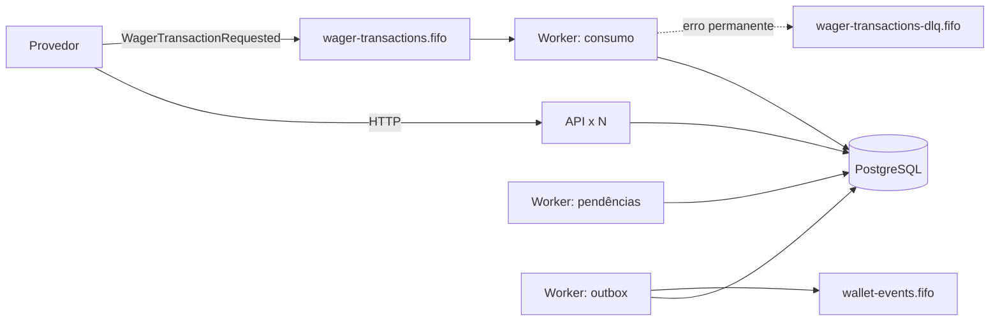
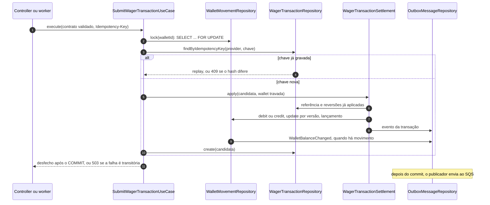

# Arquitetura

Para cada exigência do [enunciado](CHALLENGE.md), o que fiz, por quê e o que
isso custa. A seção do enunciado está entre parênteses em cada título.

## Visão geral

Dois processos, ambos escaláveis: a API HTTP e o worker, que roda três ciclos
independentes (consumo da fila, resolução de referências pendentes e
publicação da outbox). Todo estado compartilhado está no PostgreSQL. Quem
coordena instâncias concorrentes é o lock da wallet e os índices únicos, nunca
memória de processo.

Uma aposta, pela HTTP ou pela fila, segue sempre o mesmo caminho:

Wallet, lançamento, transação, inbox e outbox confirmam ou desfazem juntos,
numa única transação SQL. A resposta HTTP, o ack da fila e o envio do evento
acontecem depois do commit. Se a resposta se perde, o reenvio com a mesma chave
devolve o desfecho gravado, sem aplicar de novo.

## Autenticação (§2)

**Pedido:** opcional e sem pontos; se não implementada, a decisão, o desenho e
o ponto de extensão explícitos.

Não integrei um Identity Provider. Toda requisição passa por um `AuthGuard`
global; só os health checks são `@Public()`, e o resto pergunta a uma
`RequestAuthenticator`, hoje anônima. Rota nova nasce protegida: esquecer o
decorator fecha a rota, nunca abre. Um teste troca o autenticador por um que
recusa tudo e prova o 403 antes do banco.

Com Keycloak, eu usaria um client confidencial por provedor com
`client_credentials`, uma `JwksRequestAuthenticator` validando assinatura,
`iss`, `aud` e `exp`, e o `azp` do token como o `providerId` autorizado. Domínio,
casos de uso e controllers não mudariam. Hoje, quem alcança a porta da API pode
enviar transações.

## Stack e ORM (§4)

**Pedido:** Bun, NestJS, PostgreSQL e SQS; MikroORM preferido, com a escolha e
a estratégia transacional justificadas.

Uso MikroORM pelo que ele deixa explícito: `em.fork()` por transação com o
contexto global proibido, `transactional()` com isolamento por operação
(`READ COMMITTED` para escrita, `REPEATABLE READ` só leitura para consultas e
reconciliação) e `LockMode.PESSIMISTIC_WRITE`.

Não uso o Unit of Work implícito. Os repositórios gravam com `insert` e
`nativeUpdate`, nunca com `persist` e `flush`. Assim a ordem das escritas é a
do caso de uso, e um update que não afeta exatamente uma linha vira erro, em
vez de passar em silêncio. O custo é escrever cada update à mão.

O MikroORM 7.2.5 depende do kysely 0.29.6, que não devolvia a conexão ao pool
quando o `rollback` falhava numa conexão morta: depois de tantas quedas quanto
o tamanho do pool, a aplicação parava. Forço o kysely 0.29.7 por `overrides`,
que é a correção do próprio projeto; li o diff inteiro antes. O override sai
quando o MikroORM depender dessa versão.

Para o SQS, uso LocalStack 4.12. Testei os 17 comportamentos de SQS que a
solução usa contra LocalStack e MiniStack: o MiniStack passou em 16 (reenviar
com o mesmo `MessageDeduplicationId` e outro corpo faz o SDK acusar checksum
inválido). A imagem `latest` do LocalStack exige token desde março de 2026; a
4.12 sobe sem conta.

## Restrições do schema (§5)

**Pedido:** unicidade, imutabilidade e não negatividade aplicadas no schema, não
só no código.

Cada garantia tem uma constraint ou um trigger, e cada um tem um teste que
tenta violá-lo por SQL cru (`tests/integration/schema.integration.spec.ts`):

| Garantia | No schema |
|---|---|
| Saldo nunca negativo | `CHECK (balance >= 0)`, também nos saldos do lançamento |
| Lançamento fecha a conta | `CHECK` de `balance_after = balance_before ± amount` conforme a direção |
| Sem atualização perdida | `UNIQUE (wallet_id, wallet_version)` no ledger |
| Saldo acompanha o ledger | trigger diferido no commit: saldo e versão da wallet batem com o último lançamento |
| Ledger e outbox imutáveis | triggers que recusam `UPDATE`, `DELETE` e `TRUNCATE` |
| Idempotência por provedor | `UNIQUE (provider_id, idempotency_key)` |
| Um desfecho vivo por id externo | índice único parcial `(provider_id, external_transaction_id) where status <> 'FAILED'` |
| Transação terminal imutável | trigger que recusa `UPDATE` de terminal e transições fora da tabela do domínio |
| Reversão única | índice parcial por referência e tipo, e trigger que limita o `BET` a uma reversão líquida |
| Direção coerente com o tipo | trigger: `BET` debita, `WIN` e `REFUND` creditam, `ROLLBACK` inverte a referência |

## Dinheiro (§6.1)

**Pedido:** nada de `number`, escala fixa de 2 casas, valores em string.

O valor chega como string com exatamente duas casas
(`^(0|[1-9]\d{0,17})\.\d{2}$`), é validado por regex e nunca passa por
`Number()`. No domínio, `decimal.js` com precisão 40; na precisão padrão de 20
dígitos, uma soma perto do teto arredondava em silêncio. No banco,
`NUMERIC(20,2)`, entregue pelo driver como string e mapeado com
`p.decimal('string')`: mapear como `number` quebra o `typecheck`, e um teste
com `999999999999999999.99` confere a API e o banco.

Aceito uma única grafia por quantia porque `"25"` e `"25.00"` gerariam dois
hashes de idempotência para o mesmo pedido. Negativo só nasce dentro do domínio,
por `negate()` ou `subtract()`; o ledger grava direção mais valor positivo.

## Modelo e organização do código (§6)

**Pedido:** invariantes encapsuladas, construtor privado com `create` e
`rehydrate`, domínio sem framework nem ORM.

Cada contexto (`wallet`, `wagering`) tem `domain/`, `usecase/`, `gateway/`
(portas), `repository/` (adaptadores do MikroORM), `factory/` e `event/`. O
`bun run lint` falha se o domínio importar framework, ORM ou outra camada, se o
caso de uso importar infraestrutura, ou se um contexto importar o domínio de
outro.

Parti do desenho de monólito modular que eu já usava, com `facade/` como
interface pública de cada módulo. Tirei o facade: o controller chama o caso de
uso direto, e um contexto fala com outro por uma porta de quem consome (a
abertura de wallet usa `OpeningTransactionGateway`; as apostas movem a wallet
pelo `WalletMovementGateway`). A fachada só repetiria essas assinaturas.

Mantive a factory porque ela resolve o que o framework criaria: o caso de uso
não tem `@Injectable()`, e a factory o monta em TypeScript puro, chamada pelo
Nest com `useFactory`. Os testes de integração montam os casos de uso pela
mesma factory e trocam um gateway por um que falha para provar atomicidade. O
custo é ter mais arquivos por operação.

## Regras de negócio (§7)

**Pedido:** as regras de cada tipo, referências fora de ordem com prazo, e uma
taxonomia de `failureCode`.

`WagerTransaction.rejectionFor` concentra as regras, e a primeira falha decide,
nesta ordem: player e moeda da wallet; tipo da referência; identidade da
referência (mesma wallet, player, moeda e rodada); estado da referência;
reversão já aplicada; valor diferente; saldo e limite. Reversão sem saldo é
`REVERSAL_INSUFFICIENT_BALANCE`, distinta do `INSUFFICIENT_BALANCE` da aposta.

**Referência ausente.** A transação responde 202 e fica `PENDING_REFERENCE`. Um
ciclo do worker tenta de novo com backoff de 1 s × 2^(tentativas − 1), até 5
minutos, sem passar do prazo. A chegada da referência antecipa as pendentes que
a esperam, no mesmo commit. Sem a referência depois de uma hora
(`PENDING_REFERENCE_TTL_SECONDS`), a transação vira `REJECTED` com
`REFERENCE_NOT_FOUND` e evento de rejeição. Escolhi uma hora como janela
operacional para absorver atraso entre canais sem deixar saldo errado por tempo
indefinido; não é um SLA medido e deve ser ajustado à integração. O resolver
aplica pelo mesmo colaborador do submit, então não existe segundo caminho
financeiro.

**Taxonomia.** Cada `failureCode` pertence a uma natureza, e a natureza define o
status. O mapeamento é um `Record` exaustivo: código sem natureza não compila.

| Natureza | HTTP | Para o provedor |
|---|---|---|
| `CONTRACT` | 400 | corrigir o payload antes de reenviar |
| `CONFLICT` | 409 | reenviar igual não muda nada |
| `NOT_FOUND` | 404 | o recurso não existe |
| `BUSINESS` | 422 | desfecho terminal e auditável |
| `TRANSIENT` | 503 + `Retry-After` | reenviar com a mesma chave é seguro |
| `INTERNAL` | 500 | defeito do serviço |

A rejeição de negócio responde 422, não 201: o enunciado pede que o status
distinga rejeição de aplicação, e com 201 nos dois casos só o corpo
distinguiria. A lista completa de códigos está no [README](README.md#api).

## Concorrência (§8)

**Pedido:** estratégia livre e justificada; correção com apostas disputando o
saldo, vários workers e três ou mais instâncias.

Uso lock pessimista por wallet. A operação abre uma transação
`READ COMMITTED`, trava a wallet com `SELECT ... FOR UPDATE` e só então lê a
chave de idempotência, a referência e as reversões, e decide. O lock vive no
PostgreSQL, então vale entre processos; a ordem FIFO do SQS é otimização.

Descartei as outras opções porque a decisão depende de várias linhas lidas
antes de gravar. O otimista com retry limitado, numa hot wallet com n
concorrentes, faz n(n + 1)/2 tentativas (1.275 para 50), e o que passa do teto
vira erro. O update atômico condicionado cobre o débito, mas não as leituras
anteriores a ele. O `SERIALIZABLE` serializaria por aborto, depois do trabalho
feito.

Atrás do lock ficam duas defesas, para um erro de código virar falha e não
saldo errado: o `UPDATE` exige a versão lida e o ledger tem
`UNIQUE (wallet_id, wallet_version)`. O `lock_timeout` de 2 s limita a espera
e responde 503, sem efeito. O lock é sempre da wallet antes da linha da
transação, inclusive no resolver, para não haver ciclo de espera.

O custo é a hot wallet serial: de 40 a 87 op/s numa wallet no
[teste de carga](docs/load-test.md). Acima disso a falha é 503 rápido e seguro
de reenviar. Wallets diferentes não disputam lock.

## Idempotência (§9)

**Pedido:** `Idempotency-Key` obrigatório e fonte da verdade; reenvio devolve o
resultado original; mesma chave com outro payload é conflito.

A unicidade é `(provider_id, idempotency_key)`, então dois provedores podem usar
a mesma chave. O payload é comparado por um `payloadHash`: `v1:` mais o SHA-256
do JSON canônico dos campos de negócio, com chaves ordenadas e campos ausentes
omitidos. O prefixo de versão permite trocar o algoritmo sem confundir hashes
antigos.

A busca da chave acontece com a wallet travada, então reenvios para a mesma
wallet esperam o primeiro terminar e encontram a transação gravada. Para a
mesma chave em wallets diferentes, o índice único decide, e o perdedor refaz a
tentativa uma vez e encontra o vencedor.

Gravo também as rejeições de negócio, com o saldo observado. Assim o reenvio de
uma aposta rejeitada devolve a mesma rejeição, e não uma nova avaliação contra o
saldo de agora; e o reenvio de uma aplicada devolve o saldo daquele momento.

## Fila (§10)

**Pedido:** o mesmo caso de uso da HTTP, inbox persistente, ack depois do
commit, erros de negócio, transitórios e permanentes tratados de forma distinta,
limite de tentativas, `SIGTERM` limpo.

O worker chama o mesmo `SubmitWagerTransactionUseCase`, com um
`InboxTransactionManager` que grava `(consumer_name, message_id)` e o hash da
mensagem dentro da transação do efeito. Mensagem e efeito confirmam ou desfazem
juntos: um crash entre os dois não deixa a mensagem marcada sem efeito. O ack só
acontece depois do commit.

| Resultado | Ação |
|---|---|
| processada, rejeitada, pendente, duplicata ou replay | ack |
| falha transitória | volta à fila com backoff de 2 s × 2^(recebimentos − 1), até 300 s |
| contrato inválido, conflito ou recurso inexistente | DLQ com o atributo `failureCode` |
| erro interno | grava `FAILED` e manda para a DLQ |

Cada leitor recebe uma mensagem por vez. Medi no LocalStack que, com lotes, a
mensagem seguinte do grupo é entregue enquanto a primeira ainda está em voo, o
que quebra a ordem; recebida sozinha, a primeira segura o grupo. O custo são
duas idas ao SQS por mensagem: a fila processou de 99 a 113 mensagens/s, contra
232 a 347 op/s pela HTTP. Com `maxReceiveCount` 10 e esse backoff, a fila
absorve cerca de 18 minutos de indisponibilidade antes do redrive.

Em `SIGTERM`, o worker aborta o receive em curso, termina e confirma a mensagem
em voo, e só então fecha o pool.

**`FAILED`.** Só a fila e o resolver gravam `FAILED`. Na HTTP o provedor está
esperando a resposta e reenvia com a mesma chave, então uma falha interna
responde 500 sem gravar nada. Na fila, a transação do efeito já foi desfeita, e
gravo o `FAILED` numa transação nova, sem saldo nem lançamento, para a falha
ficar auditável. A mesma chave continua respondendo `FAILED`; para tentar de
novo, o provedor usa outra chave com o mesmo id externo. Por isso o índice do id
externo ignora `FAILED`: um `WIN` que falhou precisa poder ser pago, e
revertido depois, com o id original.

## Outbox (§11)

**Pedido:** transação, saldo, ledger, inbox e evento atômicos; publicador que
funcione com várias instâncias, sem perder evento.

Gravo os eventos na outbox na mesma transação do efeito, com uma `sequence`
atribuída com o lock da wallet retido. O publicador trava só o primeiro evento
devido de cada wallet com `SKIP LOCKED` e leva o prefixo contíguo de eventos
devidos dela; uma wallet capturada por outro publicador fica de fora daquele
lote. Assim os eventos de uma wallet saem em ordem, com vários publicadores.

A entrega é at-least-once: se o SQS recebe e o commit do lote falha, o evento
vai de novo, com o mesmo `eventId`. Quem consome deduplica por `eventId`. Não há
limite de tentativas, porque um evento financeiro confirmado não pode ser
abandonado; o atraso aparece em `outbox_lag_seconds`.

Quando um lote vem cheio (100 eventos), busco o próximo na hora. Com o
intervalo fixo de 500 ms, cada worker entregava no máximo 100 eventos por
intervalo, menos do que a carga produz, e o lag crescia. A troca tem custo: o
lag caiu pela metade, mas a consulta do lote disputa CPU do PostgreSQL, e a hot
wallet perdeu vazão no teste de carga (média de 63 contra 81 op/s). Mantive,
porque lag sem limite atrasa todo consumidor, e o 503 da hot wallet é seguro de
reenviar.

## Observabilidade (§12)

**Pedido:** logs JSON com os identificadores, sem dado sensível; métricas de
status, duplicatas, retries, DLQ, conflitos de lock, outbox lag e latência;
liveness e readiness separados.

| Métrica | Cobre |
|---|---|
| `wager_transactions_total{status, kind}` | transações por status |
| `idempotent_replays_total`, `inbox_duplicates_total` | duplicatas por chave e por entrega |
| `wager_message_retries_total`, `outbox_publish_retries_total`, `pending_reference_retries_total` | retries |
| `wager_messages_dead_lettered_total{failure_code}`, `wager_dlq_messages` | DLQ, inclusive o redrive do SQS |
| `lock_conflicts_total{reason}` | conflitos de lock |
| `outbox_lag_seconds` | outbox lag |
| `http_request_duration_seconds`, `wager_message_processing_seconds` | latência |

Os contadores só sobem depois do commit, ou depois que o SQS confirma o ack ou
o envio à DLQ: medem o efeito, não a tentativa. A profundidade da DLQ é lida no
scrape, porque o redrive do SQS move mensagens sem o worker ver. Os logs são
JSON, sem corpo de requisição, valor, saldo ou URL de conexão; um teste confere
que o valor enviado não aparece no stdout. `/health/ready` checa PostgreSQL e as
duas filas; a aplicação sobe com uma dependência fora e reconecta sozinha.

## Testes (§13)

Unidade para domínio e casos de uso, e2e para a camada HTTP sem infraestrutura,
e integração contra PostgreSQL e LocalStack reais. Os oito cenários de
concorrência do enunciado têm teste com paralelismo real, e todo teste de
integração termina conferindo que o saldo de cada wallet é o reconstruído pelo
ledger.

Para checar se os testes protegem as regras, quebrei de propósito 30 regras do
código (guarda de saldo, hash, reversões, versão, ordem da outbox, inbox,
reconciliação) e rodei a suíte para cada uma. Duas passaram despercebidas na
primeira rodada (a guarda de débito do agregado e a versão no `UPDATE` da
wallet) e ganharam teste. Hoje 29 são detectadas, e a que resta, tirar o
`lock_timeout`, faz a suíte travar em vez de falhar.

## Interpretações que adotei

- O lançamento guarda a versão da wallet (`wallet_version`), que não está no
  esqueleto do enunciado: é ela que transforma atualização perdida em violação
  de unicidade e dá ordem estável ao extrato.
- `initialBalance` é obrigatório; para abrir sem saldo, envia-se `"0.00"`.
- `LOSS` aceita valor zero; ele só registra o fim da rodada.
- A referência é proibida em `BET` e `LOSS`, porque o enunciado não a define
  para esses tipos.
- Um `WIN` só vale sobre um `BET` que ainda vale. Sem isso, o prêmio de uma
  aposta devolvida seria pago sem stake.
- A reconciliação relata divergência e nunca corrige saldo: corrigir esconderia
  a inconsistência sem uma movimentação financeira válida.

## Limitações

- **Hot wallet serial**, como descrito em Concorrência.
- **Pendência que termina em `FAILED` não publica evento**: a lista de eventos do
  enunciado não tem um para `FAILED`; o desfecho fica na consulta e nas métricas.
- **Contrato estrito na fila**: um campo novo do produtor vai para a DLQ até o
  contrato mudar.
- **Conexões**: processos × `DATABASE_POOL_MAX` precisa caber no
  `max_connections`; com muitos processos, o caminho é um PgBouncer.
- **Reverter migrations com dados**: a de ordenação da outbox só com a outbox
  drenada, e a que libera o id externo recusa enquanto houver `FAILED` repetindo
  um id.
- **Teste de carga numa máquina só, com SQS emulado**: compara cenários, não
  mede produção.
